# Little Commit Collector 🤖

A little robot collects active cells in my GitHub contribution calendar. It jumps with joy and smiles at high-activity days, with gold sparks and an XP celebration.



The animation refreshes daily at 00:00 UTC (08:00 in Ulaanbaatar). It uses the repository owner's real contribution calendar and requires no external packages or personal access token.

## Add to a GitHub profile

Paste this into your profile README:

```markdown

```

## Generate locally

Requires Python 3.12 or newer. For a preview using sample data:

```sh
python scripts/generate_train.py --demo
```

Open `dist/contribution-train.svg` in a browser. For real data, set `GITHUB_TOKEN` in your environment, then run:

```sh
python scripts/generate_robot.py --username nyamgereldavaajargal602-source
```

To refresh manually on GitHub, open **Actions → Generate contribution animations → Run workflow**.

The original [contribution train](https://raw.githubusercontent.com/nyamgereldavaajargal602-source/Train/output/contribution-train.svg) remains available and refreshes alongside the robot. The demo command above previews the train with sample data.
